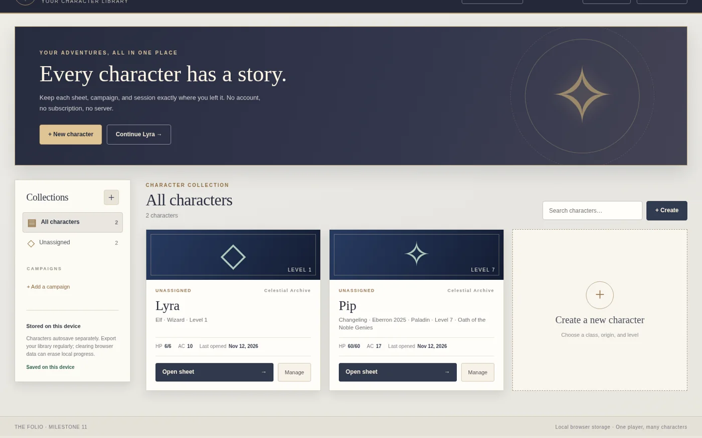
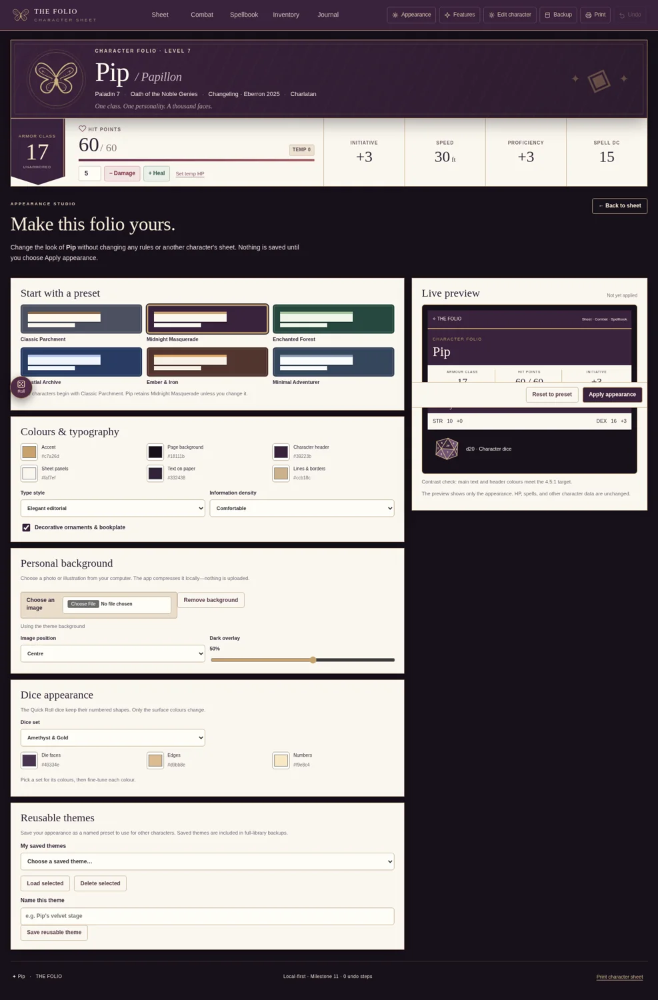
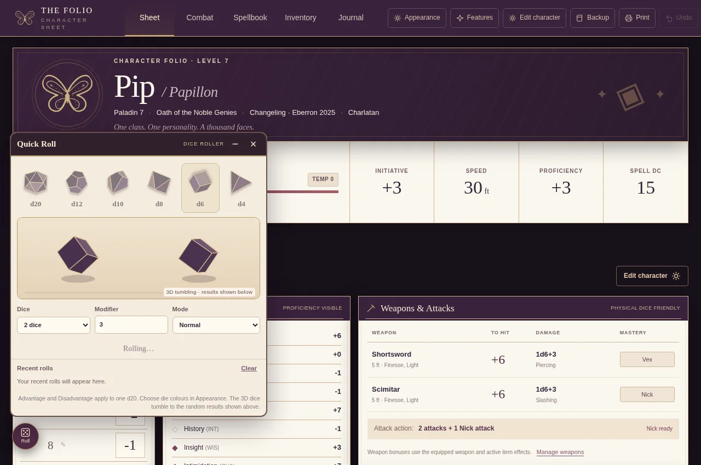
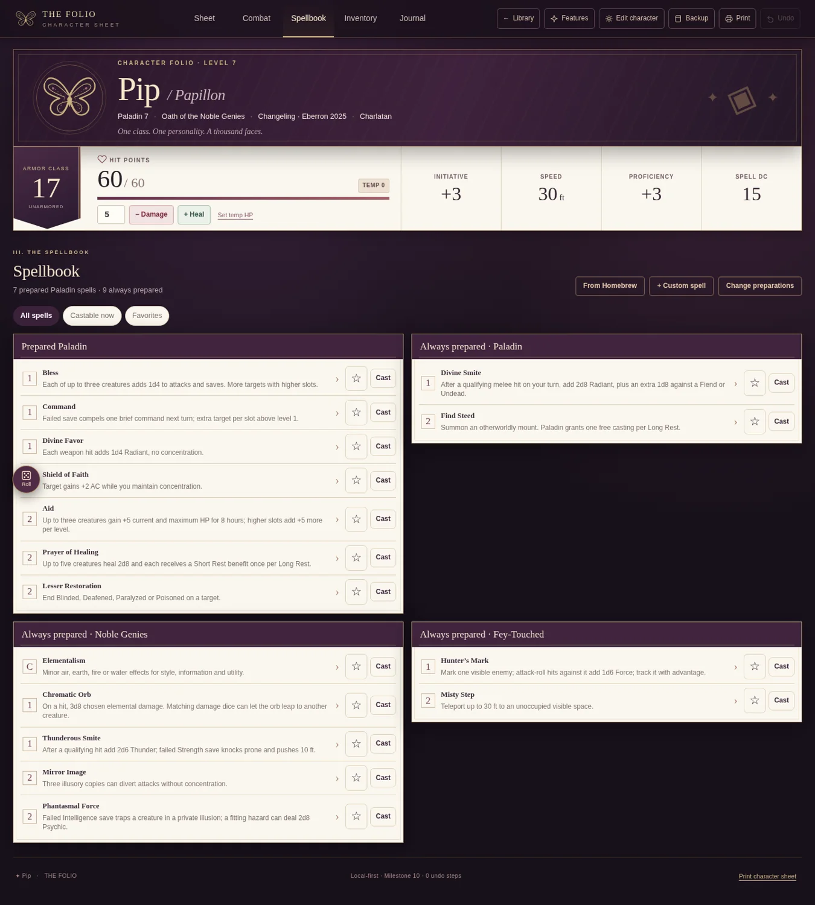
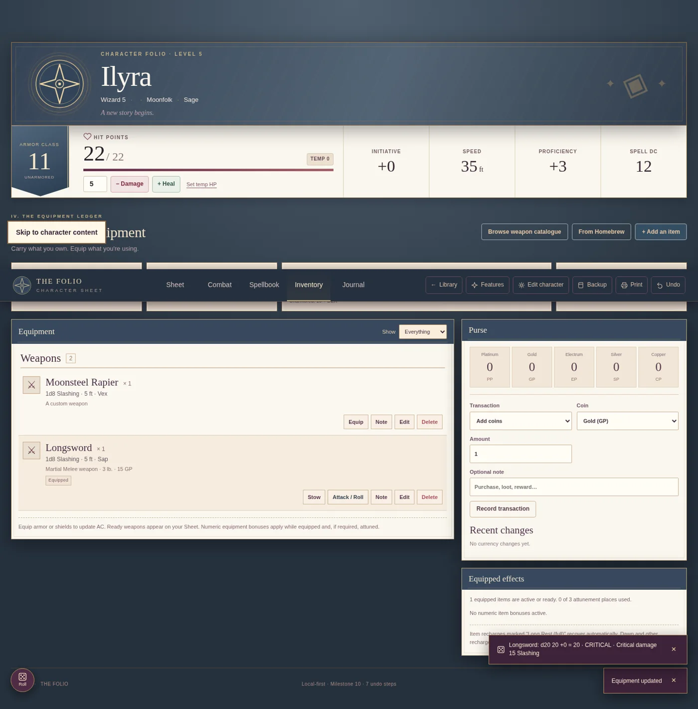

## In-person D&D first (Milestone 18.30.1)

The Folio manages your character, while **you, your friends and your DM play D&D at the table**. Roll real dice by default. For initiative, enter your real result; for weapons, open Attack details and optionally record ammunition or a thrown weapon; for Second Wind, Tireless and Wholeness of Body, spend the resource without forcing a virtual die roll. The separate digital Quick Roll and advanced attack tools are still available **only if you choose** to use them. Combat tracking is optional; ordinary HP, spellbook, rest and resource tracking works without it. See `docs/MILESTONE_18_30_1_IN_PERSON_PLAY_ALIGNMENT.md`.

### Latest release — Milestone 18.30 · PHB 24 Feats

All **42 General Feats**, **10 standard Fighting Style feats** and **12 Epic Boons** from the 2024 PHB now have selectable character-builder entries and a compact expandable **Features & Traits** panel. Feat ability-score changes, known passive modifiers, available choices, Spellbook grants, rest counters and confirmation-assisted active features are integrated. Examples include Fey-Touched, Ritual Caster, Skill Expert, Crusher, Durable, Poisoner and multiple Epic Boons. The preceding Background/Origin, Species & Traits and all twelve PHB classes remain intact. See [18.30 feat implementation audit](docs/MILESTONE_18_30_FEATS_2024_PHB.md) for manual adjudication boundaries. Preserve/export your local character saves before moving folders.

### Latest release — Milestone 18.29 · PHB 24 Backgrounds & Origin Feats

All sixteen 2024 PHB backgrounds now have usable starter equipment/tool selections and Origin feats. Background scores, skills and tools apply during creation; chosen Origin feats gain interactive choices, spellcasting, resource counters and use/rest actions on **Features & Traits**. The original library, Pip, all 12 signed-off classes, Species & Traits, campaigns and homebrew are preserved. This update remains fully offline; remote-creature/DM-controlled events are confirmed by the player. See [18.29 implementation and limitations](docs/MILESTONE_18_29_BACKGROUNDS_ORIGIN_FEATS_SIGNOFF.md).

### Latest release — Milestone 18.28 · PHB 24 Species & Traits

**All ten 2024 Player's Handbook species now have an interactive Species & Traits area**, with lineage choices, daily and short-rest resources, species spells in the shared Spellbook and relevant passive combat effects. Other-book species remain available in the Identity builder as reference entries. Standard source labels, including Oath of Devotion, show **PHB 24**, and Incoming Damage has a cleaner dialog. The full offline app and all 12 class sign-offs are retained. See [18.28 implementation and limits](docs/MILESTONE_18_28_SPECIES_2024_PHB_SIGNOFF.md).

### Latest interface update — Milestone 18.27

Damage details are now in a confirm-before-applying dialog; Spellbook filters and grouping are expandable; Custom spell contains both creation and Homebrew import. Official 2024 book listings display **PHB 24** while internal open-SRD/handbook reference provenance stays separate. The builder shows only subclasses for your chosen class. See `docs/MILESTONE_18_27_UI_POLISH.md`. Existing save folders are browser-local: export a backup before switching launch locations.

**Latest checkpoint (18.26):** Complete 2024 PHB single-class *character-sheet* coverage: **12 of 12 classes**, finishing with Wizard (Abjurer, Diviner, Evoker, Illusionist) and its persistent spellbook and high-level features. **923/923 automated tests** and **13 targeted Chromium browser suites** passed. The app remains offline, preserves all saved characters including Pip, and keeps the Windows `Open The Folio.cmd`. [Wizard completion audit](docs/MILESTONE_18_26_WIZARD_2024_PHB_SIGNOFF.md). Multiclassing, unverified source metadata, and full external creature/monster/spell adjudication remain separate work.

**Latest checkpoint (18.25):** 2024 PHB **Warlock** single-class character-sheet sign-off (levels 1–20, Archfey/Celestial/Fiend/Great Old One, Eldritch Invocations, all three Pacts and resource/spell controls). **11/12** 2024 PHB classes complete; **Wizard next**. **896 automated tests + 12 browser suites pass**. The app is still a fully offline Windows launcher + private local character library, with no login or hosted backend. Manual DM target rulings are clearly retained. See [Warlock completion audit](docs/MILESTONE_18_25_WARLOCK_2024_PHB_SIGNOFF.md).

**Latest checkpoint (18.24):** Sorcerer 2024 PHB single-class character-sheet sign-off, levels 1–20 and Aberrant, Clockwork, Draconic and Wild Magic Sorcery. Implements persistent Metamagic, Innate Sorcery, Sorcery Points/Font of Magic, resource/turn tracking, subclass spells and controls. External creature outcomes and proprietary spell effects still require DM/source confirmation. **876 automated tests** and focused browser checks passed. See [Sorcerer completion audit](docs/MILESTONE_18_24_SORCERER_2024_PHB_SIGNOFF.md). **Ten of twelve 2024 PHB classes** now signed off; next Warlock and Wizard.

**Latest checkpoint (18.23):** 2024 PHB Druid single-class character-sheet sign-off, levels 1–20 and the Circle of the Land, Moon, Sea and Stars. Known Beast stat blocks are entered from authorized sources; class-owned Wild Shape resources, form AC/HP, companion and circle mechanics are tracked, with DM-confirmed creature outcomes. **853 automated tests** and targeted browser checks passed. See [Druid completion audit](docs/MILESTONE_18_23_DRUID_2024_PHB_SIGNOFF.md). **Nine of twelve PHB classes** now signed off; next Sorcerer, Warlock and Wizard.

**Latest checkpoint (18.22):** 2024 PHB Bard character-sheet sign-off, levels 1–20 and the College of Dance, Glamour, Lore, and Valor. The existing offline application and all seven prior class sign-offs remain intact. See [Bard completion audit](docs/MILESTONE_18_22_BARD_2024_PHB_SIGNOFF.md) for exact mechanical and table-confirmed boundaries. **816 automated tests** and **nine** independent browser checks passed.

**Latest checkpoint (18.21):** 2024 PHB Cleric character-sheet sign-off, levels 1–20 and the Life, Light, Trickery, and War domains. The full local app and previous milestones remain intact. See `docs/MILESTONE_18_21_CLERIC_2024_PHB_SIGNOFF.md` for mechanics, testing, and DM-controlled outcomes.

**Current checkpoint: Milestone 18.20 — 2024 PHB Ranger character-sheet sign-off.** Ranger levels 1–20 and all four 2024 subclasses (Hunter, Beast Master, Fey Wanderer, Gloom Stalker) now have integrated sheet mechanics, resource/action tracking and tested builder flows. **758/758 Node tests and seven browser suites passed.** See [Ranger completion audit](docs/MILESTONE_18_20_RANGER_2024_PHB_SIGNOFF.md). Outside-creature outcomes and some spell effects still require player/DM confirmation; multiclassing and all-sourcebooks coverage remain future work.

**Current checkpoint: Milestone 18.19 — 2024 PHB Monk single-class character-sheet sign-off.** All four 2024 Monk subclasses are now selectable and have integrated sheet mechanics. See [the completion audit](docs/MILESTONE_18_19_MONK_2024_PHB_SIGNOFF.md). Combat outcomes involving creatures outside Folio still require player/DM confirmation; multiclassing and all-sourcebook coverage are separate future work.

**Current checkpoint: Milestone 18.18 — 2024 PHB Rogue character-sheet sign-off.** See [release audit](docs/MILESTONE_18_18_ROGUE_2024_PHB_SIGNOFF.md). The app remains local-first and offline; enemy outcomes and some spell effects require table confirmation.

## Current release: 18.17 — 2024 Barbarian class-sheet sign-off

This offline build now supports the 2024 PHB Barbarian (levels 1–20) and Berserker, Wild Heart, World Tree and Zealot, in addition to the previously signed-off Fighter and Paladin. Character creation, level gates, class-specific resources, combat rolls, subclass options, save/reopen and mobile flows were tested. **669 automated tests passed**. External creatures and DM-managed outcomes remain player-confirmed. See [Barbarian sign-off](docs/MILESTONE_18_17_BARBARIAN_2024_PHB_SIGNOFF.md).

**Current signed-off checkpoint (18.16C, Fighter 2024 PHB):** All four 2024 Fighter subclasses and Fighter levels 1–20 are supported for the intended offline character-sheet workflow. Precision, Riposte, Sweeping, Commander’s Strike, Student of War, Psi Warrior Thrust and Eldritch Knight atomic War Magic were verified alongside earlier Fighter mechanics. **634/634 Node tests** and seven targeted Chromium browser scripts passed. Enemy/ally outcomes, full spell effects and multiclassing remain outside the single-character-sheet scope. See [Fighter 18.16C sign-off](docs/MILESTONE_18_16C_FIGHTER_2024_PHB_SIGNOFF.md).

**Latest development checkpoint (18.16B — Fighter attack-linked mechanics, PARTIAL):** Battle Master hit maneuvers and Psi Warrior Psionic Strike now spend resources and apply damage through the actual weapon attack roller. The uploaded `dnd-data-main.zip` has been inspected with a read-only optional audit script; its copyrighted content is **not bundled or automatically imported**. **607 automated tests and seven completed browser suites pass.** Fighter (especially War Magic and remaining maneuvers) is not yet signed off. See [18.16B detailed implementation audit](docs/MILESTONE_18_16B_FIGHTER_ATTACK_LINKS_AND_DATA_AUDIT.md).

**Latest development checkpoint (18.16A — Fighter 2024 PHB, PARTIAL):** Added the three missing 2024 Fighter subclasses (Battle Master, Eldritch Knight, Psi Warrior) alongside Champion; live class-specific resource controls, attacks, maneuvers, Psi abilities and Eldritch Knight weapon/spell features. **593 automated tests pass.** Important combat links and external creature effects still need integration and verification. See [18.16A Fighter implementation audit](docs/MILESTONE_18_16A_FIGHTER_2024_PARTIAL.md).

**Current development checkpoint (18.15H, broad Paladin completion pass; not fully automated):** Expanded the existing 2024 PHB Paladin and four oaths with tracked weapon Attack/Extra Attack/Light/Nick/Opportunity mechanics, Unarmed Strike/grapple/shove, enemy event save/condition calculators, Glory ally speed, Ancients Swift Spells, and Paladin-only Blessed Warrior cantrips. **554 automated tests**, read-only rules inventory now **563**. External creatures, many full spell effects, multiclassing and latest all-sourcebook coverage still require work. See [`18.15H detailed Paladin completion audit`](docs/MILESTONE_18_15H_PALADIN_COMPLETION_AUDIT.md).

**Current release (18.15G, PARTIAL):** Added opt-in Paladin turn tracking for covered Actions, Bonus Actions, Reactions, and one slot-based spell cast per tracked turn. This is a compatibility-focused layer on the existing character builder, **not complete action economy**. The Paladin class and all-book rules integration remain unfinished. See [`18.15G release notes`](docs/MILESTONE_18_15G_PARTIAL_PALADIN_TURN_BUDGET.md).

**Current release (18.15F, PARTIAL):** Paladin ally aura calculators and 0-HP self aura safeguards on top of the earlier 18.15E class features. **Paladin is not complete**; enemy/ally tracking, full action economy and all official book content are unfinished. See [`18.15F implementation notes`](docs/MILESTONE_18_15F_PARTIAL_PALADIN_ALLY_AURAS.md).

**Current local checkpoint (18.15E, PARTIAL):** Added Paladin Divine Sense (shared Channel Divinity), Abjure Foes target-save resolution, and Oath of Glory Living Legend's failed-save Reaction reroll. **501 automated tests and seven offline browser regressions passed.** Complete Paladin mechanics and the full 2024/2026 rules integration remain unfinished. [Exact status and limits](docs/MILESTONE_18_15E_PARTIAL_PALADIN_CHANNEL_AND_REROLL.md).

**Current local checkpoint (18.15D, PARTIAL):** Connected Glory Glorious Defense counterattack and Living Legend Unerring Strike, plus Vengeance Relentless Avenger, to the existing weapon roller and state tracking. 488 automated tests pass. The Paladin, four oaths and 2024 PHB remain **incomplete**; source version audit remains read-only. See `docs/MILESTONE_18_15D_PARTIAL_PALADIN_FOLLOWUPS.md`.


**Latest PARTIAL build (18.15):** First PHB 2024 class-focused release: all **four Paladin oath choices** and all oath spell grants, with working Vengeance Vow/Hunter's Mark attacks, Glory ability and resource mechanics, and Ancients damage/HP protections. **Paladin is NOT complete.** [Exact worked/manual/missing audit](docs/MILESTONE_18_15_PARTIAL_PHB_PALADIN_OATHS.md).

**Previous PARTIAL build (18.14):** Added tested Oath of Devotion, Hunter and Open Hand subclass mechanics on top of 18.13. Some options still require manual adjudication; the full 2024 PHB and all-sourcebooks goal are **NOT finished**. [Detailed implemented/unfinished audit](docs/MILESTONE_18_14_PARTIAL_SRD_SUBCLASSES.md).

**Earlier PARTIAL build (18.12):** Life Domain, Fiend Patron and Draconic Sorcery now have several functional subclass mechanics and correct SRD always-prepared spell grants. **Not a complete class/subclass rules engine or 2024 PHB.** Details: [`docs/MILESTONE_18_12_PARTIAL_SUBCLASS_BATCH.md`](docs/MILESTONE_18_12_PARTIAL_SUBCLASS_BATCH.md).

**Earlier partial cross-class build (18.11):** This batch adds working Barbarian Brutal Strike and Relentless Rage, Rogue Reliable Talent, Bard Countercharm and Jack of All Trades, a shared skill/tool-check roller, and proper Initiative rolls with Feral Instinct / Champion Advantage and Surprise Disadvantage. **All 12 classes, the full PHB, and all-official-sourcebook support remain incomplete.** See [`docs/MILESTONE_18_11_PARTIAL_CROSS_CLASS_BATCH.md`](docs/MILESTONE_18_11_PARTIAL_CROSS_CLASS_BATCH.md).

**Earlier partial rules-engine build (18.9):** Fighter Action Surge, Indomitable, and multiple Champion mechanics now work, including improved critical hits, Initiative Advantage, level-7 bonus Fighting Style, Heroic Inspiration/Survivor turn effects, and Defy Death. **The Fighter class, Champion subclass, 2024 PHB, and all-official-sourcebooks goal are still incomplete.** See [`docs/MILESTONE_18_9_PARTIAL_FIGHTER_CHAMPION.md`](docs/MILESTONE_18_9_PARTIAL_FIGHTER_CHAMPION.md).

**Previous partial class-mechanics build (18.8):** Paladin Divine Smite now costs a confirmed-hit free use or slot, Radiant Strikes adds damage to Melee weapons, Lay On Hands removes eligible conditions, and always-prepared Divine Smite / Find Steed are recognized in the Spellbook. This does **not** complete Paladin, the 2024 PHB, Milestone 18 or the all-official-sourcebooks goal. See [`docs/MILESTONE_18_8_PARTIAL_PALADIN.md`](docs/MILESTONE_18_8_PARTIAL_PALADIN.md).

**Previous partial class-mechanics build (18.7):** Ranger Favored Enemy / Hunter's Mark now supports actual casting, target-specific weapon damage, concentration protection, Precise Hunter and Foe Slayer; Tireless and Nature's Veil have spendable controls. Some targeting, durations and effects remain manual. This does not complete the Ranger, PHB or all-sourcebooks goals. See [`docs/MILESTONE_18_7_PARTIAL_RANGER.md`](docs/MILESTONE_18_7_PARTIAL_RANGER.md).

**Earlier partial class-mechanics build (18.6):** Rogue Sneak Attack and Cunning Strike now apply their actual extra damage and dice costs in the weapon attack roller, with explicit trigger confirmation and once-per-turn state. This does not complete Rogue, all classes, subclasses, PHB, or all-books implementation. See [`docs/MILESTONE_18_6_PARTIAL_ROGUE_ATTACKS.md`](docs/MILESTONE_18_6_PARTIAL_ROGUE_ATTACKS.md).

**Earlier partial class-mechanics build (18.5):** Bardic Inspiration and Font of Inspiration, Fighter Tactical Mind, and Monk Focus options / initiative recovery have working resource and local HP effects. This is not a complete class, subclass, PHB, or all-books implementation. See [`docs/MILESTONE_18_5_PARTIAL_CLASS_ACTIONS.md`](docs/MILESTONE_18_5_PARTIAL_CLASS_ACTIONS.md).

<div align="center">


# The Folio

**Your characters. Your stories.**

An offline-first, customizable D&D character-sheet companion built for quick reference and real play at the table.

[](CHANGELOG.md)


[](https://github.com/itzdannys/the-folio/actions/workflows/tests.yml)

[**Quick start**](#quick-start) · [**Features**](#features) · [**Screenshots**](#screenshots) · [**Development**](#development) · [**Roadmap**](ROADMAP.md)

</div>

> **Project status:** Local alpha build (Milestone 18.16A Fighter subclass implementation, PARTIAL; Milestone 18.15I Paladin remains signed off; plus read-only rules registry; not yet published to GitHub). Functional for the supported workflows, but not a substitute for complete D&D rules references. See [limitations](#rules-coverage-and-limitations).

**Previous Milestone 18.13 (partial):** Rules-backed College of Lore, Circle of the Land and Evoker subclass controls, with verified resource spending and Circle spell grants. See [18.13 implementation and limitations](docs/MILESTONE_18_13_PARTIAL_SUBCLASS_BATCH.md).

**Previous project build: Milestone 18.10 — partial Barbarian / Berserker mechanics update.** See [M18.10 verified capabilities and limitations](docs/MILESTONE_18_10_PARTIAL_BARBARIAN_BERSERKER.md). This build implements Reckless Attack, Frenzy, Mindless Rage, Retaliation, and Intimidating Presence controls. Earlier Fighter, Paladin, Ranger and other class-mechanics features are retained. This does **not** finish the 2024 Player’s Handbook, every core class feature, or all official sourcebooks. The previous spell index remains at 430 names (339 SRD records + 91 reference-only entries).

**Earlier project build: Milestone 17.6 (supplement spell references).** The unified catalogue indexes **430 spell names**: 339 licensed SRD rules entries, 52 2024 PHB-only references, and 39 references from four additional official books. Reference-only spells still require the actual books for casting mechanics. Existing 144-entry equipment and 38-weapon catalogues remain. See [M17.6 release notes](docs/MILESTONE_17_6_RELEASE_NOTES.md). Supporting all official sourcebooks remains a staged goal, not finished catalogue coverage.


## Why The Folio?

I started The Folio because I wanted an easier way to stay organized during D&D sessions. Between a character sheet, spell descriptions, inventory, and notes from previous games, it was easy for important details to end up scattered around. I wanted the familiar layout of a traditional character sheet, with a few digital conveniences that made it easier to focus on actually playing.

What began as a tool for one rather disorganized player grew into something I could reuse for different characters and campaigns. The Folio keeps HP, features, spells, attacks, equipment, and notes together, with automatic local saving and optional digital dice. It runs offline, with no account, server, or subscription needed to play.

**Pip / Papillon** was the original character I built it around and is still included as an example. His butterfly-and-masquerade theme is one option, not the default: each character can have their own build, homebrew, and appearance.

## Features

| Character management | At the table | Personalization |
| :--- | :--- | :--- |
| Multiple characters and campaign folders | HP, concentration popups, conditions and initiative | Six built-in appearance themes |
| 12-class, single-class character builder | Spellbook and preparation workspace | Custom colors, backgrounds, fonts and portraits |
| Level 1–20 numerical progression | 430-name spell index (339 SRD rules + 91 references) | Customizable dice colors |
| Reusable homebrew options | 38-weapon catalogue and attack tools | Choose a portrait, emblem or token independently for sheet and library |
| Library and character JSON backups | 3D animated Quick Roll with real dice results | Token-maker PNG export, layout reset and movable panels |
| Autosave and Undo | Combat plays, inventory and campaign journal | Works locally with no account |
| Per-character spell folders and saved sets | Purpose grouping, favorites and fast spell filters | Collapsible spell groups |

<details>
<summary><strong>What does the dice roller actually simulate?</strong></summary>

Quick Roll uses 3D polygon meshes to render tumbling dice. The **result comes from a separate random-number generator**. The animation is not rigid-body collision physics, and it does not infer the result by reading a physical landing face. You can always roll physical dice instead.

</details>

## Screenshots

<details open>
<summary><strong>Character library</strong></summary>



</details>

<table>
<tr><td width="50%" valign="top"><strong>Appearance Studio</strong><br/></td><td width="50%" valign="top"><strong>3D Quick Roll</strong><br/></td></tr>
<tr><td width="50%" valign="top"><strong>Pip's grouped Spellbook</strong><br/></td><td width="50%" valign="top"><strong>Weapon catalogue</strong><br/></td></tr>
</table>

<sub>Screenshots are from Milestones 10–12 development builds and may contain example character data.</sub>

## Quick start

### Windows — no installation necessary

1. Download this repository as a ZIP (**Code → Download ZIP**) and choose **Extract All**. Alternatively, clone the repository.
2. Open the extracted project folder.
3. Double-click **`Open The Folio.cmd`**. It opens the local `index.html` in your default browser. You can also open `index.html` directly.
4. From **Your Characters**, open Pip or create a new character.
5. On a character sheet, choose **Options → Artwork & tokens** in the top toolbar to upload a portrait, customize the emblem, or make a token.

**No Node.js, account, server, or internet connection is required for ordinary play.** The `.cmd` file is a launcher, not an installer.

### Upgrading from an earlier Folio folder

1. **Export a full Library JSON backup first** from the old app. Save it outside the Folio folder.
2. Extract this build into a separate folder as a safe test copy. If your characters do not appear, use **Import backup**. A new folder path can use different browser storage.
3. Check the Sheet, Concentration reminder, Inventory, and new Artwork Studio, then continue using the new folder (or carefully copy the updated files into the existing one). Do not delete the old folder until everything is verified.

### Organizing spells (Milestone 16)

1. Open **Spellbook**. The familiar **By source** groups are still the default, and their left icons collapse/expand the group.
2. Choose **By purpose** for Offense, Defense, Healing, Control, Utility, Exploration, Social, and Ritual. A spell can appear in multiple purpose groups; these are discovery labels, not additional spell rules.
3. Choose **Manage folders & labels** to make personal folders or labels. Use the **File** button next to a spell to put it in a folder, add labels, or add more purposes.
4. Choose **Folders** to browse by your own folders. Or choose **Saved sets**, enter a name, and save a reference snapshot of the character's currently selected spells for quick viewing. These saved sets do not change actual preparation or spend spell slots; Pip's existing preparation loadouts remain in Change preparations.
5. Filter by name, level, school, casting time, concentration, ritual, source, or current castability. Select a spell to see details; Elementalism now explains all five modes.

Spell organization belongs to the individual character and is backed up with the rest of your data. Changing categories **never** changes known/prepared spells, caster features, or available spell slots.

### Unified Spellbook index (Milestone 17.6)

- Use **Spellbook → Manage spells / Change preparations** to browse the unified 430-name index. Filter by **Source** to distinguish bundled SRD rules from PHB and other commercial-book references.
- For an entry marked **Reference only**, open **Details** to see its known name, level, source and class lists. Check your own book for its casting time, components, concentration, targets, effects, and higher-slot rules; Folio does not make those up.
- Reference entries can be selected and a slot can be recorded, but that **does not resolve the spell**. Track the effect and any concentration manually. SRD spell details and the 339 personalized guidance entries still work normally.
- To add personal spell metadata from other books, use **Library → Rules & Sources → Import source pack**. See `docs/SOURCE_PACKS.md` for JSON format and the sample file. This does **not** install copyrighted sourcebooks or make their effects automated.

### Personal portraits and tokens (Milestone 14)

1. Open a character and select **Options → Artwork & tokens** in the top toolbar. You can also reach it from **Appearance Studio**.
2. Choose a PNG, JPEG, or WebP image for **Character portrait** (up to 8 MB); a compressed copy is stored **on your device**.
3. Optionally upload a different **Sheet emblem**. All characters—including Pip—start with the Folio open-book icon. Use **Pip’s butterfly** if you want the original theme, or upload your own image.
4. Under **Choose what people see**, select the image for the sheet icon (emblem or framed token) and the library card (portrait, emblem, or framed token). These are separate choices.
5. In **Tabletop token**, choose the portrait or emblem for the inside of the token, change the border shape and color, and drag to reposition. Zoom with a slider or by scrolling over the preview. The controls sit directly below the preview.
6. To use the framed token beside your character name, click **Use this token as sheet icon** directly beneath the preview. This saves and returns to the Sheet page. Otherwise choose **Download token PNG** to export it, or **Save artwork** to save your other changes.

By default, a character with a portrait displays that portrait on their library card. You can instead select the emblem or token; the sheet icon has its own independent setting. The token can also be downloaded as an image. Portrait rotation, independent portrait crops, and drag-and-drop file upload are not implemented yet; image repositioning works in the token editor. **Export a library backup after importing artwork**, particularly if your browser falls back to localStorage.

### Rearranging your character sheet (Milestone 15)

1. Open a character and select the **Sheet** tab.
2. Select **Edit layout** at the top-right of the Character Sheet section. Your sheet becomes three labelled columns.
3. **Drag to move** a panel by the handle just below its title. An insertion marker shows where it will land; panels move when you release the mouse, preventing flicker. Or tap the **← ↑ ↓ →** buttons to rearrange it. You can move Ability Scores, Saving Throws, Skills, Conditions & Concentration, Weapons & Attacks, Resources, and Features & Traits. The top character banner and HP/AC bar stay pinned.
4. Choose **Save layout** to keep the arrangement, **Cancel** to discard the draft, or **Restore default** (then **Save layout**) to get back the standard setup. The standard Sheet view has only the **Edit layout** button; resetting is done inside the layout editor.

Every character has their own layout, stored locally with their other data and included in backups. Collapsed panels are temporarily expanded while editing; their collapse preferences return afterward. The three-column arrangement stacks naturally on mobile. There is no dragging in normal sheet mode.

### Returning to the app

Use the same browser and project location each time. You can create a desktop shortcut to `Open The Folio.cmd` using **right-click → Show more options → Send to → Desktop (create shortcut)**.

### Saving and backups

- Completed edits **autosave locally**. Undo is available for supported changes.
- Use **Export library** to download a portable JSON backup with your characters, campaigns, homebrew, saved themes, and artwork/tokens.
- Use **Import backup** to restore data into the library. Individual character exports made with Milestone 14 also include that character’s artwork; older character backups still import.
- Save your backup **outside this repository**. Local browser storage is not cloud sync and may be cleared.
- Moving to a different browser, folder path, or `http://localhost` origin may mean importing your JSON backup again.

For more details about local storage and backup recovery, see [Data and privacy](docs/DATA_AND_PRIVACY.md).

## Development

The app uses **plain HTML, CSS, and JavaScript**. Runtime dependencies are bundled. Node.js is only needed to run tests or the optional development server.

```bash
# Run the source tests (Node.js 18+)
npm test

# Optional local development server (NOT required to play)
npm start
```

For the optional development server, open `http://127.0.0.1:4173`. Browser storage at this address is **separate** from the `file://` version.

Optional Playwright/Chromium browser checks are described in [TESTING.md](TESTING.md). They are **not** included in the default GitHub Actions job.

### Repository structure

```text
.
├── index.html                  # Offline entry point
├── Open The Folio.cmd          # Windows launcher
├── assets/                     # Folio seal, Pip butterfly, and dice icons
├── css/                        # Layout and appearance
├── js/                         # Character, spell, weapon, dice and storage logic
├── tests/                      # Node and optional browser regression checks
├── docs/                       # Screenshots, architecture, and data guidance
├── .github/workflows/          # Automated source tests
└── README.md
```

[Architecture overview](docs/ARCHITECTURE.md) · [Test notes](TESTING.md) · [Roadmap](ROADMAP.md)

## Rules coverage and limitations

The Folio is a **tabletop companion**, not a fully automated rules authority. Class progression includes numerical support for levels 1–20, but complex features, subclass abilities, spell learning, encounter targeting, and action economy still require player judgment. **Multiclassing is not implemented.** Pip's original Noble Genies configuration remains specialized to its supported levels.

The spell catalogue contains **339 SRD records** with individual Milestone 16.1 gameplay guidance and the full bundled reference wording, not every spell in all published books. See `docs/SPELL_GUIDANCE_AUDIT.md` for coverage and limits. Character data based on non-SRD sourcebooks is represented through limited original summaries or editable personal data. The sourcebook reference manager exists. M17.2 adds 16 PHB background entries and 25 feat choices; M17.3 adds 26 selectable species names with source-labelled traits, validated species selections, and simple species metadata imports. Reference-only book species do not include full proprietary rules or automated powers. Source preferences do not yet comprehensively filter the whole builder.

See [Known limitations and planned improvements](ROADMAP.md), [Spell data terms](SPELL_DATA_LICENSE.md), and [Weapon data terms](WEAPON_DATA_LICENSE.md).

## Attribution & rights

**Project author and maintainer:** [Danny (@itzdannys)](https://github.com/itzdannys).

The Folio builds on earlier personal Folio milestones and incorporates selected logic and catalogues from **Character Keeper** with the original creator's permission. The adapted components and rules-material provenance are described in [ATTRIBUTION.md](ATTRIBUTION.md). This is not an official Wizards of the Coast product.

D&D SRD 5.2.1 material © Wizards of the Coast LLC is made available under [CC BY 4.0](https://creativecommons.org/licenses/by/4.0/); attribution details are included in the data-license files.

**Source licensing:** No general open-source license has been granted for the application code in this repository. Rights to third-party materials remain with their owners. See [RIGHTS.md](RIGHTS.md). A public-source license can be chosen later after confirming permissions for every included component.

---

<div align="center">

Made and maintained by **[Danny · @itzdannys](https://github.com/itzdannys)**

*Play the character. Keep the story.*

</div>


### Rules & Sources (Milestones 17.1–17.3)

From the Library, open **Rules & Sources** to manage optional sourcebook references or import your own metadata-only JSON packs. The app now follows **one current-rules baseline: revised D&D 5e (2024), with the bundled SRD 5.2.1 always on**. Campaigns and characters can still inherit or customize their *reference sources*, but there is **no 2014/2024 edition switch**. Historic 17.1 edition preferences migrate automatically without touching sheets, spell slots, or HP. Older non-superseded options can be used when compatible; selecting a source never installs unbundled commercial material or implements its features. Imported source-pack backgrounds, feats, and species can now also be selected in the builder using verified or user-entered simple metadata (not full book text). See [Source pack format and limitations](docs/SOURCE_PACKS.md) and [Milestone 17.3 notes](docs/MILESTONE_17_3_RELEASE_NOTES.md).


### Milestone 18.15B source-version audit (read-only integration)

Run `npm run audit:rules` to inspect source identity and version review status. This adds no runtime network dependency and does not change character saves, builder options, or mechanics. Only five Paladin-related source identities have been checked for this audit; all existing Paladin and other class mechanics remain subject to the prior documented limitations. See `docs/MILESTONE_18_15B_VERSIONED_RULES_AUDIT_INTEGRATION.md`.
