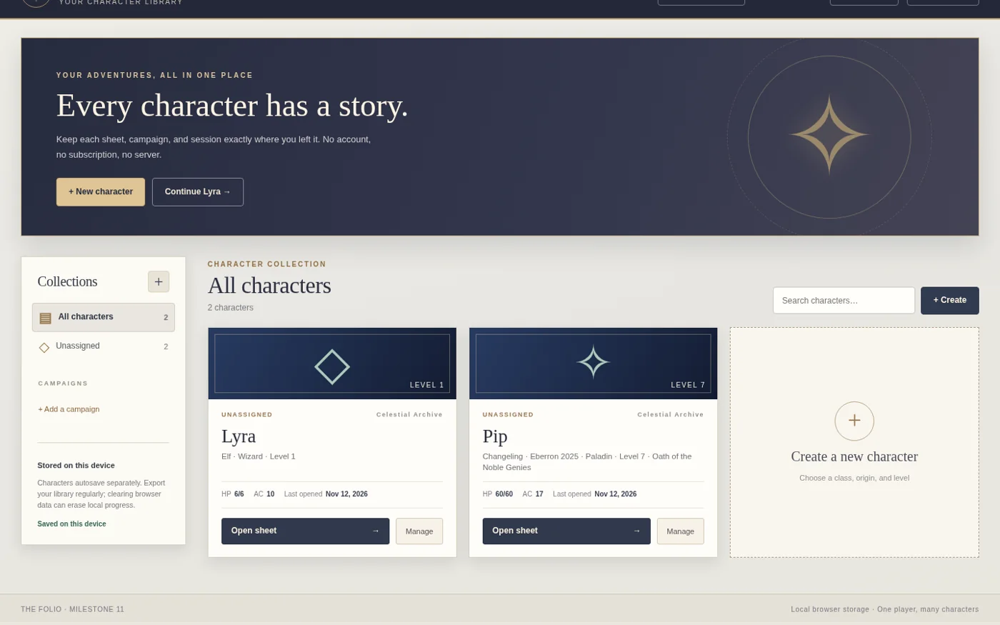
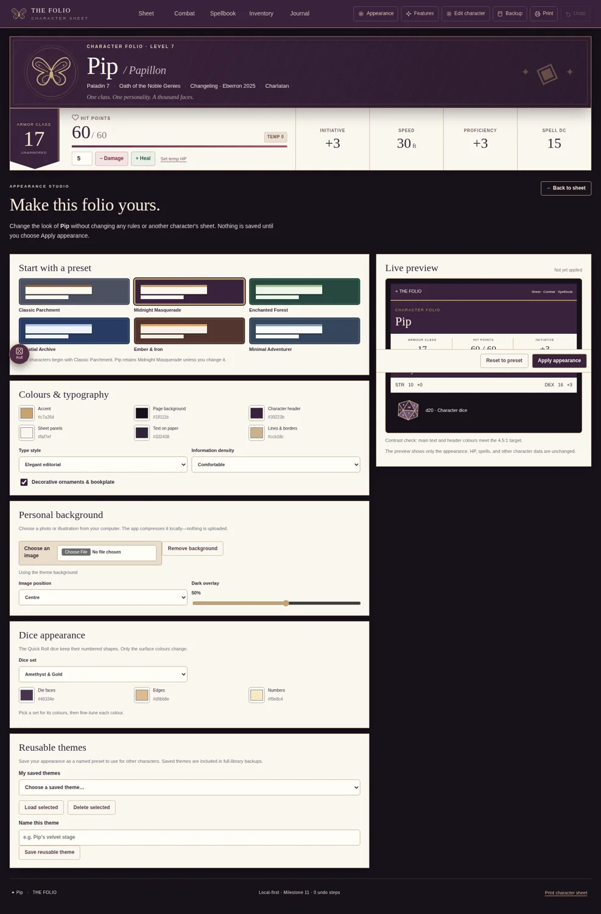
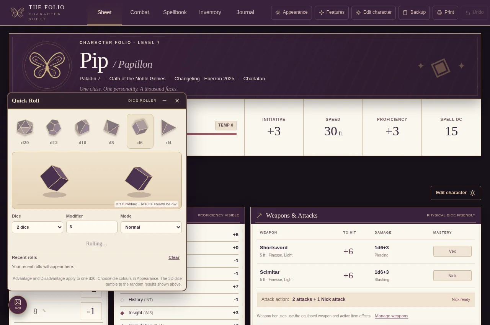
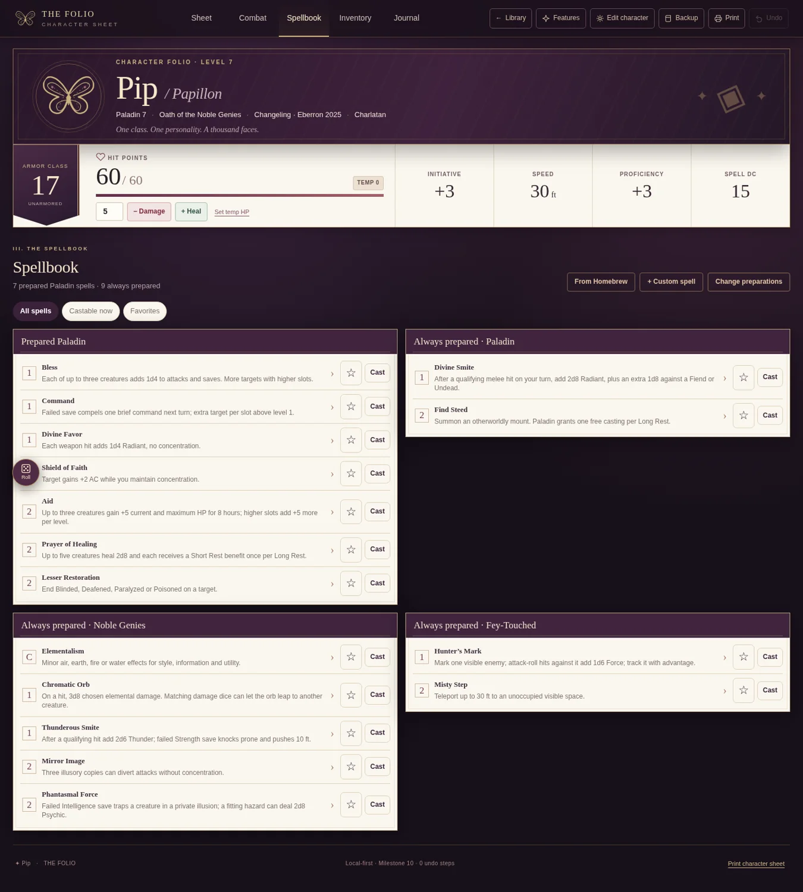
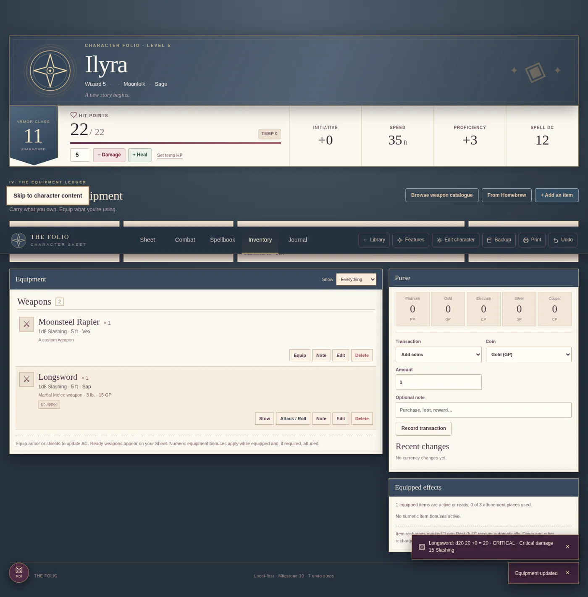

<div align="center">


# The Folio

**Your characters. Your stories.**

An offline-first, customizable D&D character-sheet companion built for quick reference and real play at the table.

[](CHANGELOG.md)


[](https://github.com/itzdannys/the-folio/actions/workflows/tests.yml)

[**Quick start**](#quick-start) · [**Features**](#features) · [**Screenshots**](#screenshots) · [**Development**](#development) · [**Roadmap**](ROADMAP.md)

</div>

> **Project status:** Personal alpha release (Milestone 12). Functional for the supported workflows, but not a substitute for complete D&D rules references. See [limitations](#rules-coverage-and-limitations).

## Why The Folio?

I started The Folio because I wanted an easier way to stay organized during D&D sessions. Between a character sheet, spell descriptions, inventory, and notes from previous games, it was easy for important details to end up scattered around. I wanted the familiar layout of a traditional character sheet, with a few digital conveniences that made it easier to focus on actually playing.

What began as a tool for one rather disorganized player grew into something I could reuse for different characters and campaigns. The Folio keeps HP, features, spells, attacks, equipment, and notes together, with automatic local saving and optional digital dice. It runs offline, with no account, server, or subscription needed to play.

**Pip / Papillon** was the original character I built it around and is still included as an example. His butterfly-and-masquerade theme is one option, not the default: each character can have their own build, homebrew, and appearance.

## Features

| Character management | At the table | Personalization |
| :--- | :--- | :--- |
| Multiple characters and campaign folders | HP, conditions, concentration and initiative | Six built-in appearance themes |
| 12-class, single-class character builder | Spellbook and preparation workspace | Custom colors, backgrounds and fonts |
| Level 1–20 numerical progression | 339-entry SRD spell catalogue | Customizable dice colors |
| Reusable homebrew options | 38-weapon catalogue and attack tools | Per-character settings |
| Library and character JSON backups | 3D animated Quick Roll with real dice results | Printable character-sheet view |
| Autosave and Undo | Combat plays, inventory and campaign journal | Works locally with no account |

<details>
<summary><strong>What does the dice roller actually simulate?</strong></summary>

Quick Roll uses 3D polygon meshes to render tumbling dice. The **result comes from a separate random-number generator**. The animation is not rigid-body collision physics, and it does not infer the result by reading a physical landing face. You can always roll physical dice instead.

</details>

## Screenshots

<details open>
<summary><strong>Character library</strong></summary>



</details>

<table>
<tr><td width="50%" valign="top"><strong>Appearance Studio</strong><br/></td><td width="50%" valign="top"><strong>3D Quick Roll</strong><br/></td></tr>
<tr><td width="50%" valign="top"><strong>Pip's grouped Spellbook</strong><br/></td><td width="50%" valign="top"><strong>Weapon catalogue</strong><br/></td></tr>
</table>

<sub>Screenshots are from Milestones 10–12 development builds and may contain example character data.</sub>

## Quick start

### Windows — no installation necessary

1. Download this repository as a ZIP (**Code → Download ZIP**) and choose **Extract All**. Alternatively, clone the repository.
2. Open the extracted project folder.
3. Double-click **`Open The Folio.cmd`**. It opens the local `index.html` in your default browser. You can also open `index.html` directly.
4. From **Your Characters**, open Pip or create a new character.

**No Node.js, account, server, or internet connection is required for ordinary play.** The `.cmd` file is a launcher, not an installer.

### Returning to the app

Use the same browser and project location each time. You can create a desktop shortcut to `Open The Folio.cmd` using **right-click → Show more options → Send to → Desktop (create shortcut)**.

### Saving and backups

- Completed edits **autosave locally**. Undo is available for supported changes.
- Use **Export library** to download a portable JSON backup with your characters, campaigns, homebrew, and saved themes.
- Use **Import backup** to restore data into the library.
- Save your backup **outside this repository**. Local browser storage is not cloud sync and may be cleared.
- Moving to a different browser, folder path, or `http://localhost` origin may mean importing your JSON backup again.

For more details about local storage and backup recovery, see [Data and privacy](docs/DATA_AND_PRIVACY.md).

## Development

The app uses **plain HTML, CSS, and JavaScript**. Runtime dependencies are bundled. Node.js is only needed to run tests or the optional development server.

```bash
# Run the source tests (Node.js 18+)
npm test

# Optional local development server (NOT required to play)
npm start
```

For the optional development server, open `http://127.0.0.1:4173`. Browser storage at this address is **separate** from the `file://` version.

Optional Playwright/Chromium browser checks are described in [TESTING.md](TESTING.md). They are **not** included in the default GitHub Actions job.

### Repository structure

```text
.
├── index.html                  # Offline entry point
├── Open The Folio.cmd          # Windows launcher
├── assets/                     # Butterfly artwork and dice icons
├── css/                        # Layout and appearance
├── js/                         # Character, spell, weapon, dice and storage logic
├── tests/                      # Node and optional browser regression checks
├── docs/                       # Screenshots, architecture, and data guidance
├── .github/workflows/          # Automated source tests
└── README.md
```

[Architecture overview](docs/ARCHITECTURE.md) · [Test notes](TESTING.md) · [Roadmap](ROADMAP.md)

## Rules coverage and limitations

The Folio is a **tabletop companion**, not a fully automated rules authority. Class progression includes numerical support for levels 1–20, but complex features, subclass abilities, spell learning, encounter targeting, and action economy still require player judgment. **Multiclassing is not implemented.** Pip's original Noble Genies configuration remains specialized to its supported levels.

The spell catalogue contains **339 SRD records**, not every spell in all published books. Character data based on non-SRD sourcebooks is represented through limited original summaries or editable personal data.

See [Known limitations and planned improvements](ROADMAP.md), [Spell data terms](SPELL_DATA_LICENSE.md), and [Weapon data terms](WEAPON_DATA_LICENSE.md).

## Attribution & rights

**Project author and maintainer:** [Danny (@itzdannys)](https://github.com/itzdannys).

The Folio builds on earlier personal Folio milestones and incorporates selected logic and catalogues from **Character Keeper** with the original creator's permission. The adapted components and rules-material provenance are described in [ATTRIBUTION.md](ATTRIBUTION.md). This is not an official Wizards of the Coast product.

D&D SRD 5.2.1 material © Wizards of the Coast LLC is made available under [CC BY 4.0](https://creativecommons.org/licenses/by/4.0/); attribution details are included in the data-license files.

**Source licensing:** No general open-source license has been granted for the application code in this repository. Rights to third-party materials remain with their owners. See [RIGHTS.md](RIGHTS.md). A public-source license can be chosen later after confirming permissions for every included component.

---

<div align="center">

Made and maintained by **[Danny · @itzdannys](https://github.com/itzdannys)**

*Play the character. Keep the story.*

</div>
